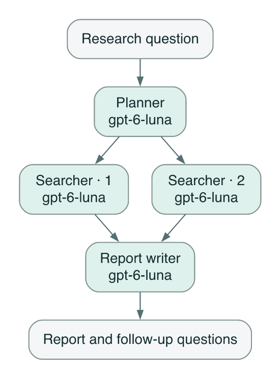
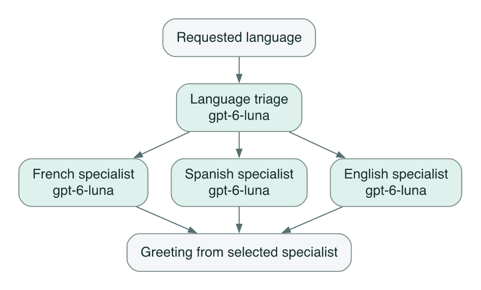
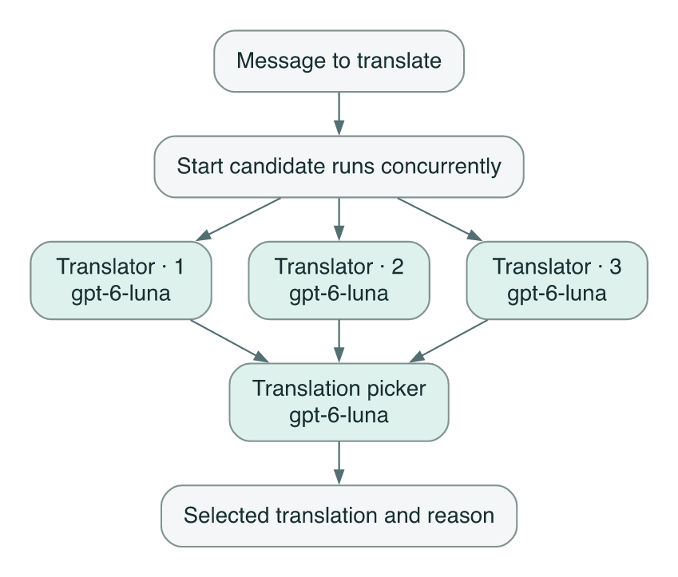
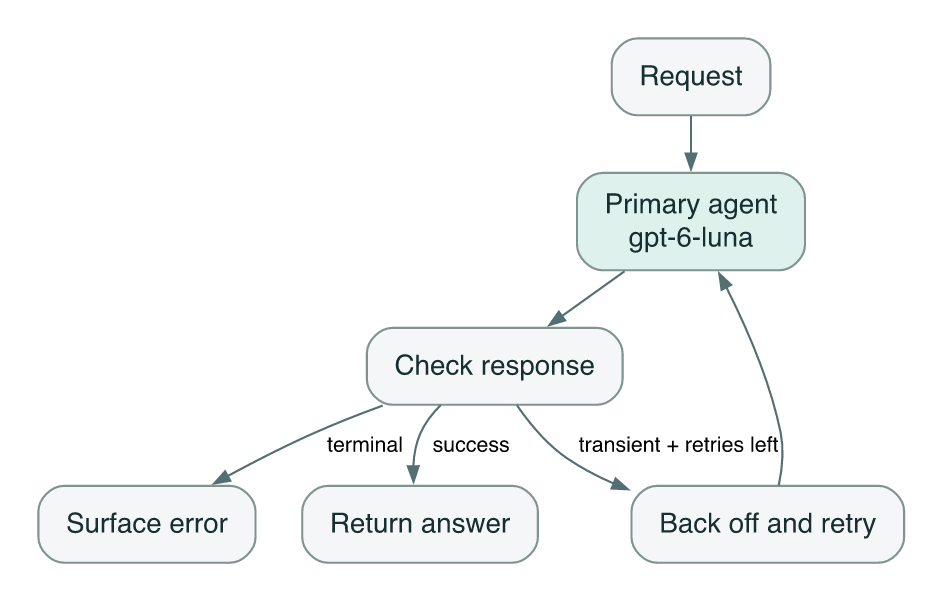
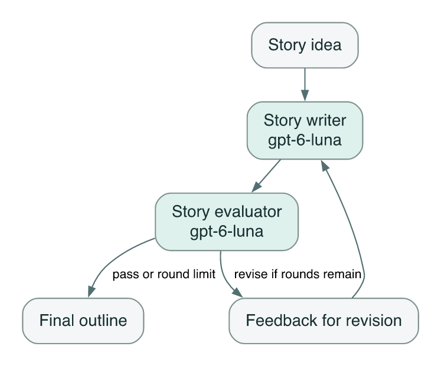
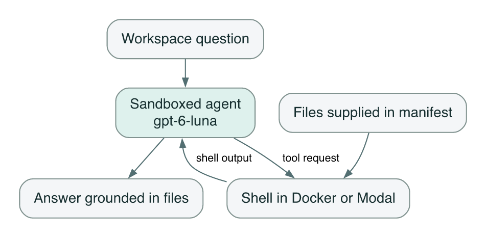

# Agent Pattern Examples

## About this project

Learn common agent architecture patterns by implementing them with the OpenAI Agents SDK.

Each pattern includes an architecture diagram, a runnable Python example, and a step-by-step Jupyter notebook. The six patterns cover planning, handoffs, parallel execution, retries, evaluation and refinement, and sandboxed execution.

## Patterns

| Pattern | Diagram | Example | Workflow | Notebook |
|---|---|---|---|---|
| [Workflow planning](patterns/workflow_planning/) |  | Writing a research report | Plan searches → search concurrently → write a report | [English notebook](patterns/workflow_planning/examples/research_report/notebooks/workflow_planning-en.ipynb) |
| [Triage hand-off](patterns/triage_handoff/) |  | Routing to language specialists | Identify the requested language → hand control to a specialist | [English notebook](patterns/triage_handoff/examples/language_routing/notebooks/triage_handoff-en.ipynb) |
| [Parallel execution](patterns/parallel_execution/) |  | Selecting a translation | Generate three translations concurrently → choose the best | [English notebook](patterns/parallel_execution/examples/translation_candidates/notebooks/parallel_execution-en.ipynb) |
| [Retry or fallback](patterns/retry_or_fallback/) |  | Retrying transient errors | Classify the error → back off → retry (no backup model) | [English notebook](patterns/retry_or_fallback/examples/transient_error_retry/notebooks/retry_or_fallback-en.ipynb) |
| [Evaluator-optimiser](patterns/evaluator_optimiser/) |  | Refining a story outline | Draft → evaluate → incorporate feedback → repeat | [English notebook](patterns/evaluator_optimiser/examples/story_refinement/notebooks/evaluator_optimiser-en.ipynb) |
| [Sandboxed agent](patterns/sandboxed_agent/) |  | Inspecting a sandbox workspace | Prepare files → create a sandbox → inspect files with a shell → answer | [English notebook](patterns/sandboxed_agent/examples/workspace_inspection/notebooks/sandboxed_agent-en.ipynb) |

## How the patterns relate to familiar programming concepts

These analogies connect agent patterns to familiar programming concepts. Each highlights one aspect of the pattern.

| Agent pattern | Programming concept | How it works |
|---|---|---|
| **Workflow planning** | Task decomposition and orchestration | Break a goal into tasks, run them sequentially or concurrently according to the plan, then combine the results. |
| **Triage hand-off** | Conditional branching and control transfer | Choose an agent as in an `if–else` or `switch` and delegate the rest of the run to it. |
| **Parallel execution** | Fork–join | Run independent tasks concurrently and collect their results for the next step. |
| **Retry or fallback** | Exception handling, retry, and fallback | Classify an error, then retry within a limit or switch to another model or processing path. |
| **Evaluator-optimiser** | Evaluate–refine loop | As in a `while` or `repeat–until` loop, evaluate and revise until the result meets the quality criteria or reaches the iteration limit. |
| **Sandboxed agent** | Isolated execution environment | Use process, container, or VM isolation to limit the resources and operations available to code. |

The first five patterns focus on **control flow**. The sandboxed agent focuses on **execution environments and isolation**. The retry example implements only the retry path.

## Directory structure

```text
agent-pattern-examples/
├── README.md
├── THIRD_PARTY_NOTICES.md
├── UPSTREAM.json
├── requirements.txt
├── requirements-notebooks.txt
├── docs/
│   ├── setup.md
│   ├── notebook-validation.md
│   ├── contributing.md
│   ├── code-organization.md
│   └── assets
│       └── agent-patterns
├── scripts/       # Development tools, including notebook validation
├── tests/         # Tests for validation, Colab, and sandbox support
└── patterns/
    ├── workflow_planning/examples/research_report/
    ├── triage_handoff/examples/language_routing/
    ├── parallel_execution/examples/translation_candidates/
    ├── retry_or_fallback/examples/transient_error_retry/
    ├── evaluator_optimiser/examples/story_refinement/
    └── sandboxed_agent/examples/workspace_inspection/
```

Each pattern has a `README.md` listing its examples. Each example follows this layout.

```text
<example>/
├── README.md
├── src/
│   ├── __init__.py
│   └── main.py      # Entry point. Larger examples also have modules organized by role.
└── notebooks/
    ├── README.md
    └── <pattern>-en.ipynb
```

Keep example code in `src/`. Add `data/` and `outputs/` only when needed. See the [contributing guide](docs/contributing.md) for example and notebook conventions and the [code organization guide](docs/code-organization.md) for directory structure, entry points, and module boundaries.

Choose an example in a pattern README, then open the example README for details and commands.

## Notebook

Open `notebooks/<pattern>-en.ipynb` inside an example. The guided exercises skip API calls by default. To enable them, set `RUN_API=True` in the setup cell. The standalone example near the end has its own `run_api=True` argument. [Environment setup](docs/setup.md) · [Notebook validation](docs/notebook-validation.md)

All six notebooks support local Jupyter and Colab. For Colab, choose **File → Upload notebook** and select the English notebook from this clone. The first setup cell installs the Colab dependencies. A repository checkout or Drive mount inside Colab is unnecessary.

Offline runs require neither an API key nor a `.env.local` file. For live calls in Colab, add `OPENAI_API_KEY` to Secrets and grant notebook access. An existing environment variable takes precedence. Colab does not automatically receive your local `.env.local`. See [Running in Colab](docs/setup.md#running-in-colab).

## Shared installation

The commands below install the shared CLI dependencies. For local notebooks use `requirements-notebooks.txt`. See [environment setup](docs/setup.md) for Jupyter, Docker, and Modal.

You'll need Python 3.10 or later and pip. Run the following from the repository root.

```bash
python -m venv .venv
source .venv/bin/activate
python -m pip install -r requirements.txt
```

Live API calls require `OPENAI_API_KEY` and may incur charges. Set the environment variable before running the CLI. Local notebooks use `find_dotenv()` to look for an optional `.env.local` in the working directory and its parents. Existing environment variables take precedence. Keep API keys out of source files and commits.

Each example README includes its run command. From the example directory, run `python -m src.main`. The SDK dependency is the PyPI package `openai-agents[docker]==0.22.1`.

## Scope of the examples

- **Workflow planning** plans searches, runs them, and writes a report. General-purpose dependency management is outside its scope.
- **Parallel execution** generates several candidates for the same task and selects one. The workflow planning example also runs distinct searches concurrently.
- **Retry or fallback** uses the official retry example. Switching to a backup model is outside its scope.
- **Evaluator-optimiser** revises a draft using feedback. The evaluator can make mistakes and final quality varies.
- **Sandboxed agent** defaults to local Docker or Modal in Colab. Use `SANDBOX_BACKEND` to override it. Modal requires a separate account and authentication and may incur charges in addition to model API fees. In Colab, store `MODAL_TOKEN_ID` and `MODAL_TOKEN_SECRET` in Secrets. See [sandbox setup](docs/setup.md#sandbox-example). Saving and resuming sessions are outside this example's scope.
- The CLI and notebooks default to `gpt-6-luna`. The notebooks adjust iteration limits and search counts for the exercises. Each example README explains the differences under “Notebook and CLI differences.” Confirm model access in your environment before running.

## Source code

- Upstream repository: [OpenAI Agents SDK for Python](https://github.com/openai/openai-agents-python)
- Pinned commit: [`25af629b3c877ba3d0e95189141bb636b21167a5`](https://github.com/openai/openai-agents-python/tree/25af629b3c877ba3d0e95189141bb636b21167a5)
- SDK package: [`openai-agents` 0.22.1 on PyPI](https://pypi.org/project/openai-agents/0.22.1/)
- Each `src/` directory adapts an official example. Four entry points simplify input handling. Imports and run instructions reflect the standardized file paths and entry points. The provenance records identify changes and original hashes for each file.
- [UPSTREAM.json](UPSTREAM.json) lists original paths and SHA-256 hashes. Modified files include original and local hashes and a description of the changes.
- [THIRD_PARTY_NOTICES.md](THIRD_PARTY_NOTICES.md) contains the original copyright notice and MIT license.
- The pattern, example, and notebook guides, the `docs/` directory, the root README, and configuration files were added for this collection.

### Upstream code by pattern

The links below point to the commit used when copying the examples.

| Pattern | Upstream file |
|---|---|
| Workflow planning | [openai-agents-python/examples/research_bot/manager.py](https://github.com/openai/openai-agents-python/blob/25af629b3c877ba3d0e95189141bb636b21167a5/examples/research_bot/manager.py) |
| Triage hand-off | [openai-agents-python/examples/agent_patterns/routing.py](https://github.com/openai/openai-agents-python/blob/25af629b3c877ba3d0e95189141bb636b21167a5/examples/agent_patterns/routing.py) |
| Parallel execution | [openai-agents-python/examples/agent_patterns/parallelization.py](https://github.com/openai/openai-agents-python/blob/25af629b3c877ba3d0e95189141bb636b21167a5/examples/agent_patterns/parallelization.py) |
| Retry or fallback | [openai-agents-python/examples/basic/retry.py](https://github.com/openai/openai-agents-python/blob/25af629b3c877ba3d0e95189141bb636b21167a5/examples/basic/retry.py) |
| Evaluator-optimiser | [openai-agents-python/examples/agent_patterns/llm_as_a_judge.py](https://github.com/openai/openai-agents-python/blob/25af629b3c877ba3d0e95189141bb636b21167a5/examples/agent_patterns/llm_as_a_judge.py) |
| Sandboxed agent | [openai-agents-python/examples/sandbox/basic.py](https://github.com/openai/openai-agents-python/blob/25af629b3c877ba3d0e95189141bb636b21167a5/examples/sandbox/basic.py) |

## License

The copied official examples use the MIT license. [THIRD_PARTY_NOTICES.md](THIRD_PARTY_NOTICES.md) preserves the copyright notice and full license text. Include both when redistributing the source.

## Validation

The original project checked upstream hashes for unmodified files, local hashes for modified files, Python syntax, and local example import paths. Its static checks did not run the CLI examples. See the [notebook validation record](docs/notebook-validation.md) for installation and execution results.

After installing the notebook environment, run `python scripts/check_notebooks.py` from the repository root for offline validation. Select an example with `--example language_routing`. Use `--live` to enable real API calls in the guided exercises. A full live run also requires the selected sandbox backend. Results are saved to `.cache/notebook-validation.json`.

Run `python -m unittest discover -s tests -v` for the validation tool, Colab, and sandbox tests. The Modal adapter test is skipped when its optional dependency is absent. The [validation record](docs/notebook-validation.md#rerunning-validation) covers installation and scope. The original project verified local execution and simulated Colab behavior. Hosted Colab and remote Modal execution remained unverified.
